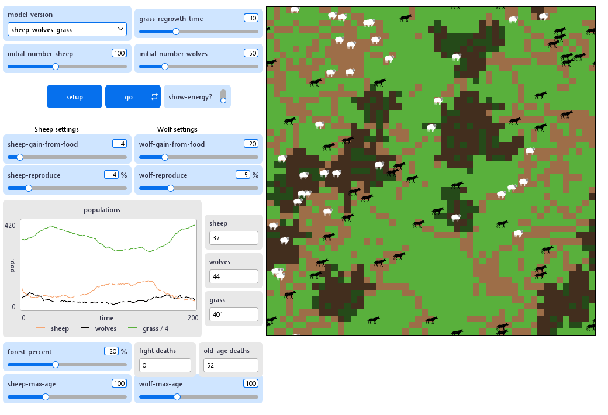
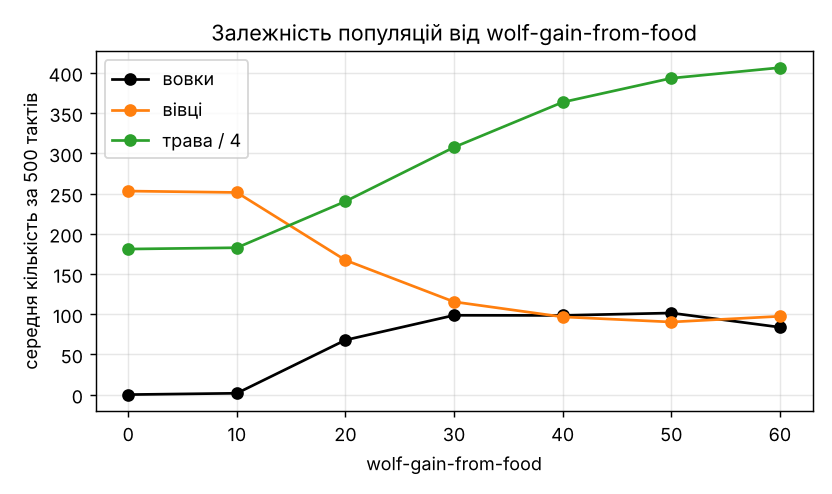
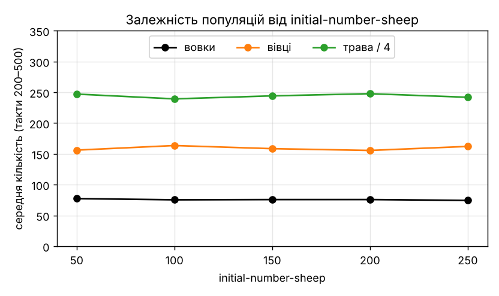
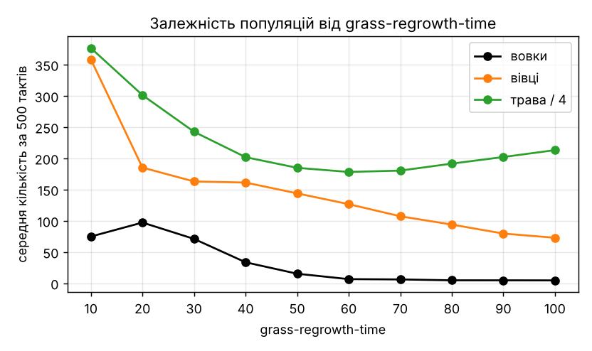
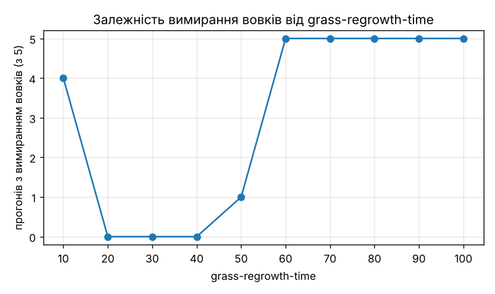

## Комп'ютерні системи імітаційного моделювання
## СПм-25-1, Турбаба Данило Володимирович
### Лабораторна робота №**1**. Опис імітаційних моделей та проведення обчислювальних експериментів

 

### Варіант 7, модель у середовищі NetLogo:
[Wolf Sheep Predation](http://www.netlogoweb.org/launch#http://www.netlogoweb.org/assets/modelslib/Sample%20Models/Biology/Wolf%20Sheep%20Predation.nlogo)

Дослідження виконувалось у десктопній версії NetLogo 7.0.4 (Sample Models → Biology → Wolf Sheep Predation), версія моделі `sheep-wolves-grass`.

 

### Вербальний опис моделі:
Модель описує екосистему «хижак – жертва – ресурс». На полі живуть вівці (жертви) та вовки (хижаки). Вовки та вівці переміщуються полем випадковим чином. Кожен крок коштує тварині одиницю енергії. Вовки отримують енергію, з'їдаючи овець, які опинилися з ними на одній ділянці. Вівці отримують енергію, поїдаючи траву. Тварина, у якої енергія стала від'ємною, гине. Кожна тварина на кожному такті з певною ймовірністю народжує одного нащадка і віддає йому половину своєї енергії.

Трава росте на ділянках поля. З'їдена ділянка стає коричневою і відростає через задану кількість тактів.

Модель демонструє циклічні коливання чисельності популяцій, характерні для систем «хижак – жертва» (аналог рівнянь Лотки – Вольтерри). Також вона показує, за яких умов система стійка, а за яких один із видів (або обидва) вимирає.

Модель має дві версії (перемикач **model-version**):
- `sheep-wolves`: вівці не потребують їжі, трави немає. Така система зазвичай нестійка.
- `sheep-wolves-grass`: вівці харчуються травою, трава відростає. Додатковий трофічний рівень робить систему стійкішою. **Саме ця версія використовується в роботі.**

### Керуючі параметри:
- **model-version**: версія моделі (з травою або без неї).
- **initial-number-sheep**: початкова кількість овець (0–250, за замовчуванням 100).
- **initial-number-wolves**: початкова кількість вовків (0–250, за замовчуванням 50).
- **sheep-gain-from-food**: скільки енергії отримує вівця, з'ївши траву на одній ділянці (за замовчуванням 4).
- **wolf-gain-from-food**: скільки енергії отримує вовк, з'ївши вівцю (за замовчуванням 20).
- **sheep-reproduce**: імовірність (у %), що вівця народить нащадка на поточному такті (за замовчуванням 4%).
- **wolf-reproduce**: імовірність (у %), що вовк народить нащадка на поточному такті (за замовчуванням 5%).
- **grass-regrowth-time**: через скільки тактів з'їдена трава відростає (за замовчуванням 30).
- **show-energy?**: показувати енергію агентів підписами (на роботу моделі не впливає).

### Внутрішні параметри:
- **energy**: енергія кожної тварини. Початкове значення випадкове, від 0 до `2 × gain-from-food`.
- **countdown**: лічильник тактів до відростання трави на ділянці.
- **max-sheep**: верхня межа кількості овець (30000 у десктопній версії). Якщо вовків немає, а овець стало більше, симуляція зупиняється.
- **витрата енергії за такт** - 1 одиниця. Задана прямо в коді процедури `go` (`set energy energy - 1`), повзунка для неї немає. Вовки витрачають енергію завжди, вівці - лише у версії `sheep-wolves-grass`.
- **кут повороту і довжина кроку** - задані в процедурі `move`: `rt random 50`, `lt random 50`, `fd 1`. Тварина повертає праворуч на випадковий кут 0–49°, потім ліворуч на 0–49°, тобто в сумі від −49° до +49° (найчастіше близько 0°), і робить крок на 1 ділянку.

### Показники роботи моделі:
- **sheep**: поточна кількість овець.
- **wolves**: поточна кількість вовків.
- **grass**: кількість трави. Увага: і монітор, і графік показують `count grass / 4`, тобто кількість ділянок із травою, поділену на 4.
- графік **populations**: зміна чисельності всіх трьох складових у часі.

### Алгоритм зміни стану моделі (один такт):
1. Якщо тварин не лишилось, симуляція зупиняється.
2. Кожна вівця: повертає на випадковий кут і робить крок; витрачає 1 енергії; якщо стоїть на траві, з'їдає її (ділянка стає коричневою, вівця отримує `sheep-gain-from-food`); гине, якщо енергія < 0; з імовірністю `sheep-reproduce` народжує ягня.
3. Кожен вовк: робить випадковий крок; витрачає 1 енергії; якщо на його ділянці є вівця, з'їдає одну (+`wolf-gain-from-food`); гине, якщо енергія < 0; з імовірністю `wolf-reproduce` народжує вовченя.
4. Кожна коричнева ділянка зменшує свій `countdown` і знову заростає травою, коли він досягне нуля.
5. Модельний час збільшується на 1 такт.

### Недоліки моделі:
- **Вовки не полюють, а блукають навмання.** Хижак не бачить жертву навіть на сусідній ділянці, а вівця не тікає від хижака, що стоїть поруч. Поведінка обох видів однаково «сліпа».
- **Розмноження не залежить від енергії.** Вовк, у якого лишилась 1 одиниця енергії, розмножується з тією ж імовірністю, що й ситий.
- **Тварини не старіють.** Сита тварина може жити необмежено довго, смерть настає тільки від голоду або від зубів вовка.
- **Поле однорідне.** Немає місцевості, де жертва могла б сховатися (ліс, нори, скелі), хоча в реальних екосистемах укриття суттєво впливають на стійкість.
- **Ходи несправедливо впорядковані.** Спочатку на кожному такті ходять усі вівці, потім усі вовки.
- **Тварина, створена на старті, може мати енергію 0** (`random (2 × gain-from-food)` може дати 0) і загинути на першому ж такті. При `wolf-gain-from-food = 0` так гинуть усі вовки.

 

## Обчислювальні експерименти

**Загальні умови для всіх експериментів:**
- версія моделі `sheep-wolves-grass`;
- тривалість кожного прогону 500 тактів;
- для кожного значення параметра виконано 5 прогонів, у таблицях наведено середнє;
- параметри, що не досліджуються, мають значення за замовчуванням: `initial-number-sheep` = 100, `initial-number-wolves` = 50, `sheep-gain-from-food` = 4, `sheep-reproduce` = 4, `wolf-gain-from-food` = 20, `wolf-reproduce` = 5, `grass-regrowth-time` = 30.

Прогони автоматизовано командою у Командному центрі NetLogo, яка записувала кількість овець, вовків і трави на кожному такті у csv-файли (`exp1.csv`, `exp2.csv`, `exp3.csv`). Ті самі експерименти збережено в BehaviorSpace у файлі [Wolf Sheep Predation (ЛР1).nlogox](<Wolf Sheep Predation (ЛР1).nlogox>) (Средства → BehaviorSpace → `ЛР1 exp1…exp3`), тож їх можна перезапустити з інтерфейсу.

 

### 1. Вплив сили хижаків на чисельність вовків, овець і трави
Досліджується залежність середньої кількості вовків, овець і трави (за 500 тактів) від параметра **wolf-gain-from-food**, тобто від того, скільки енергії вовк отримує від з'їденої вівці. Значення: від 0 до 60 із кроком 10.

Перевіряється припущення: чим ефективніше полюють вовки, тим їх більше, тим менше овець і, як наслідок, тим більше трави. Вовки не їдять траву, але впливають на неї через овець. Такий ланцюговий вплив називають трофічним каскадом.

<table>
<thead>
<tr><th>wolf-gain-from-food</th><th>Вовки</th><th>Вівці</th><th>Трава (grass)</th></tr>
</thead>
<tbody>
<tr><td>0</td><td>0,1</td><td>253,1</td><td>181,0</td></tr>
<tr><td>10</td><td>1,8</td><td>251,3</td><td>182,6</td></tr>
<tr><td>20</td><td>67,9</td><td>167,2</td><td>240,3</td></tr>
<tr><td>30</td><td>98,7</td><td>115,4</td><td>307,5</td></tr>
<tr><td>40</td><td>98,5</td><td>96,7</td><td>363,5</td></tr>
<tr><td>50</td><td>101,5</td><td>90,3</td><td>393,3</td></tr>
<tr><td>60</td><td>83,8</td><td>97,4</td><td>406,4</td></tr>
</tbody>
</table>

*Кількість трави наведена так само, як її показують монітор **grass** і графік **populations** у моделі, тобто `count grass / 4` (кількість ділянок із травою, поділена на 4). Реальна кількість ділянок із травою вчетверо більша.*

Припущення підтвердилось:
- При значеннях 0 і 10 вовки не можуть прогодуватися і вимирають. Без хижаків овець найбільше (~250), а трави найменше (~181).
- Починаючи з 20 вовки виживають. Їх стає більше, овець менше, а трава поступово відновлюється. При 60 її більш ніж удвічі більше, ніж без вовків.
- Після 30 кількість вовків перестає зростати і тримається біля 100, а при 60 навіть трохи падає. Овець стає замало, щоб прогодувати більше хижаків.

 

### 2. Вплив початкової кількості овець
Досліджується залежність середньої кількості вовків, овець і трави від параметра **initial-number-sheep**. Значення: від 50 до 250 із кроком 50. Середнє рахується за такти 200–500, тобто після того, як система «заспокоїлась» після старту.

Перевіряється припущення: початкова кількість овець впливає лише на початок симуляції, а далі система виходить на один і той самий рівень.

<table>
<thead>
<tr><th>initial-number-sheep</th><th>Вовки</th><th>Вівці</th><th>Трава (grass)</th></tr>
</thead>
<tbody>
<tr><td>50</td><td>77,4</td><td>156,1</td><td>247,1</td></tr>
<tr><td>100</td><td>75,4</td><td>163,6</td><td>239,4</td></tr>
<tr><td>150</td><td>75,8</td><td>158,5</td><td>244,2</td></tr>
<tr><td>200</td><td>75,8</td><td>155,6</td><td>247,8</td></tr>
<tr><td>250</td><td>74,5</td><td>162,1</td><td>241,9</td></tr>
</tbody>
</table>

*Трава, як і в експерименті 1, наведена в одиницях монітора grass (`count grass / 4`).*

Припущення підтвердилось: стартова кількість овець змінювалась уп'ятеро, а після 200-го такту всі три показники майже однакові: близько 160 овець, 75 вовків і 239–248 трави. Відмінності між значеннями не більші за звичайний випадковий розкид між прогонами. Отже, стан, до якого приходить модель, визначають її параметри (харчування, розмноження, ріст трави), а не початкова кількість агентів.

 

### 3. Вплив швидкості відростання трави
Досліджується залежність середньої кількості вовків, овець і трави (за 500 тактів), а також кількості прогонів (із 5), у яких вимерли вовки, від параметра **grass-regrowth-time**. Значення: від 10 до 100 із кроком 10. Чим менше значення, тим швидше відростає трава.

Перевіряється припущення: система стійка лише при помірній швидкості росту трави. Якщо трава росте занадто повільно, вовкам не вистачить овець. Якщо занадто швидко, вівці розмножаться вибухоподібно, за ними вовки, після чого настане обвал.

<table>
<thead>
<tr><th>grass-regrowth-time</th><th>Вовки</th><th>Вівці</th><th>Трава (grass)</th><th>Прогонів, у яких вимерли вовки (з 5)</th></tr>
</thead>
<tbody>
<tr><td>10</td><td>74,6</td><td>358,2</td><td>376,4</td><td>4</td></tr>
<tr><td>20</td><td>97,0</td><td>185,0</td><td>301,1</td><td>0</td></tr>
<tr><td>30</td><td>70,9</td><td>162,8</td><td>242,4</td><td>0</td></tr>
<tr><td>40</td><td>33,4</td><td>161,1</td><td>201,7</td><td>0</td></tr>
<tr><td>50</td><td>15,1</td><td>143,8</td><td>184,7</td><td>1</td></tr>
<tr><td>60</td><td>6,4</td><td>126,5</td><td>178,1</td><td>5</td></tr>
<tr><td>70</td><td>5,9</td><td>107,1</td><td>180,2</td><td>5</td></tr>
<tr><td>80</td><td>4,6</td><td>93,8</td><td>191,4</td><td>5</td></tr>
<tr><td>90</td><td>4,5</td><td>79,4</td><td>202,0</td><td>5</td></tr>
<tr><td>100</td><td>4,4</td><td>72,7</td><td>213,0</td><td>5</td></tr>
</tbody>
</table>

*Трава, як і в попередніх експериментах, наведена в одиницях монітора grass (`count grass / 4`).*

Припущення підтвердилось:
- **Дуже швидка трава (10).** Овець у середньому найбільше (~358), але вовки вимирали у 4 прогонах із 5. Чисельність різко коливається: вівці розмножуються вибухоподібно, вовки теж, а після обвалу вовки гинуть. Середня кількість вовків (~75) тут не низька, бо вимирання відбувалось не раніше ~200-го такту, а до того вовків було багато.
- **Помірна швидкість (20–40).** Вовки виживали в усіх прогонах. Найбільше вовків при 20 (~97). Сюди ж потрапляє значення за замовчуванням (30).
- **Повільна трава (60 і більше).** Вовки вимирають у всіх прогонах, а кількість овець поступово падає з ~126 до ~73: їх тепер обмежує лише нестача їжі. Трави після 60 знову поступово більшає (з ~178 до ~213), бо овець, які її їдять, стає менше.
