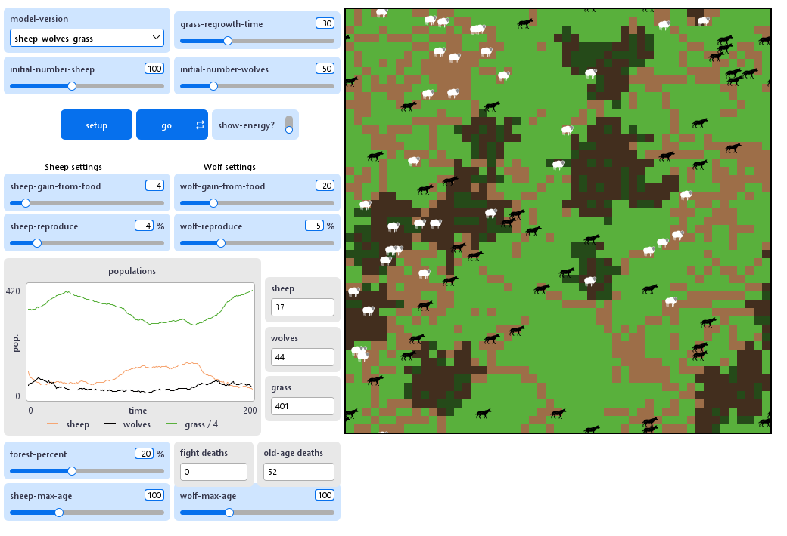
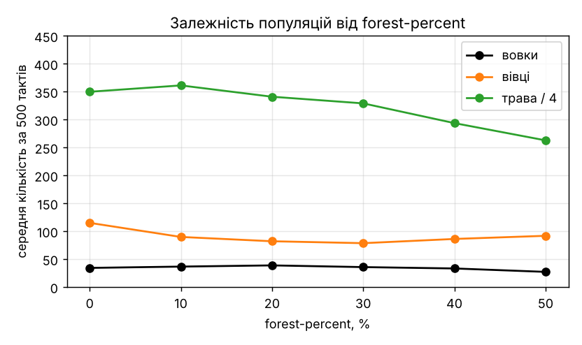
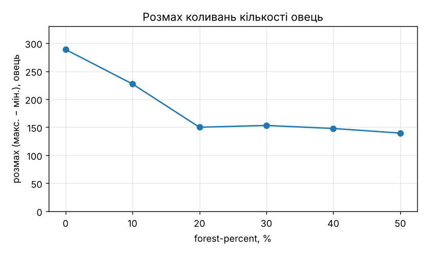
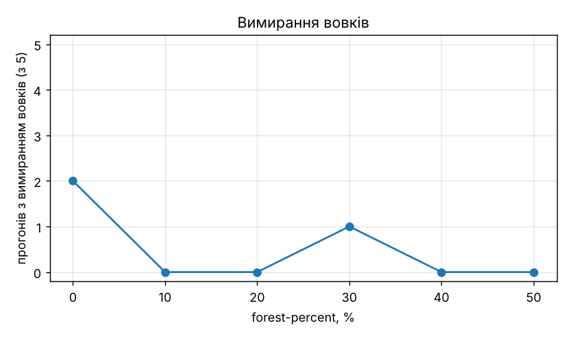
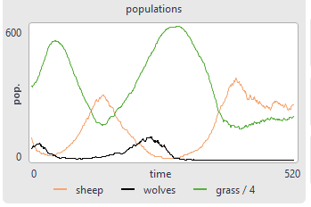
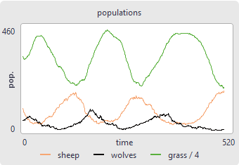

## Комп'ютерні системи імітаційного моделювання
## СПм-25-1, Турбаба Данило Володимирович
### Лабораторна робота №**2**. Редагування імітаційних моделей у середовищі NetLogo

 

### Варіант 7, модель у середовищі NetLogo:
[Wolf Sheep Predation](http://www.netlogoweb.org/launch#http://www.netlogoweb.org/assets/modelslib/Sample%20Models/Biology/Wolf%20Sheep%20Predation.nlogo)

Зміни вносились у десктопній версії NetLogo 7.0.4, бо вони зачіпають і інтерфейс (нові слайдери та монітори). Фінальна модель: [Wolf Sheep Predation (ЛР2).nlogox](<Wolf Sheep Predation (ЛР2).nlogox>). У коді всі змінені й додані місця позначені коментарем `[ЛР2]`.

 

### Внесені зміни у вихідну логіку моделі, за варіантом:

**1. Вовки-одинаки замість «зграї».** У вихідній моделі вовки, як і вівці, повертали на випадковий кут і робили крок (`move`), тож часто збивались у купи. Тепер перед ходом вовк «оглядається»: перевіряє 8 сусідніх ділянок і обирає напрямок, виходячи з наявності овець і відсутності інших вовків. Якщо поруч немає ні овець, ні вільних ділянок, вовк рухається випадково, як раніше.
<pre>
to move-wolf  ; wolf procedure
  let options neighbors with [ not forest? and not any? wolves-here ]
  let with-prey options with [ any? sheep-here ]
  ifelse any? with-prey
    [ move-to max-one-of with-prey [ count sheep-here ] ]
    [ ifelse any? options
        [ move-to one-of options ]
        [ ; немає іншої можливості - випадковий крок (але не в ліс)
          rt random 50
          lt random 50
          if patch-ahead 1 != nobody and not [ forest? ] of patch-ahead 1 [ fd 1 ] ] ]
end
</pre>
Тут `options` - це сусідні ділянки без інших вовків (і не ліс, див. зміну 4), а `with-prey` - ті з них, де є вівці. Вовк іде туди, де овець найбільше.

**2. На одній ділянці може залишитись лише один вовк.** Якщо після переміщення на ділянці опинилось кілька вовків, виживає найсильніший, тобто той, що має найбільше енергії. Кількість загиблих у таких сутичках рахується у глобальній змінній `fight-deaths`, яку виведено на монітор.
<pre>
to fight  ; wolf procedure
  if any? other wolves-here [
    let winner max-one-of wolves-here [ energy ]
    let losers wolves-here with [ self != winner ]
    set fight-deaths fight-deaths + count losers
    ask losers [ die ]
  ]
end
</pre>
Процедура викликається одразу після переміщення вовка:
<pre>
  ask wolves [
    move-wolf
    fight
    set energy energy - 1
    eat-sheep
    ...
</pre>
Під час ініціалізації вовки також розставляються по одному на ділянку:
<pre>
move-to one-of patches with [ not forest? and not any? wolves-here ]
</pre>

**3. Вівці тікають від вовків.** Вівця, як і раніше, рухається випадково. Але якщо на одній із сусідніх ділянок вона бачить вовка, вона розвертається від найближчого вовка у протилежний бік (`face` на вовка + `rt 180`).
<pre>
to move-sheep  ; sheep procedure
  let danger wolves-on neighbors
  ifelse any? danger [
    let shelter neighbors with [ forest? and not any? wolves-here ]
    ifelse any? shelter
      [ move-to one-of shelter ]
      [ face min-one-of danger [ distance myself ]
        rt 180
        fd 1 ]
  ]
  [ move ]
end
</pre>
Гілка з `shelter` належить до власної зміни 4: якщо поруч є ліс, вівця не просто тікає, а ховається в ньому.

 

### Внесені зміни у вихідну логіку моделі, на власний розсуд:

**4. Ліс-укриття.** У лабораторній роботі №1 серед недоліків моделі було відзначено, що поле однорідне і жертві ніде сховатися. Тому на поле додано ліс. Його частку від площі поля задає новий слайдер **forest-percent** (0–50%, за замовчуванням 15%).
- Ліс складається з кількох плям-кластерів, а не з розкиданих поодиноких клітин. Спочатку обирається кілька «зерен», потім ліс розростається на сусідні ділянки, доки не займе потрібну частку поля:
<pre>
to setup-forest
  let target round (count patches * forest-percent / 100)
  if target = 0 [ stop ]
  ask n-of (max list 1 round (target / 60)) patches [ set forest? true ]
  while [ count patches with [ forest? ] < target ] [
    ask one-of patches with [ forest? ] [ ask one-of neighbors4 [ set forest? true ] ]
  ]
end
</pre>
- **Вовки в ліс не заходять** (умова `not forest?` у `move-wolf`). Вовченя, що народилось на краю лісу і «випало» в ліс, повертається на ділянку батька.
- **Вівці ховаються в лісі** від вовків (див. `move-sheep`).
- Щоб укриття не стало «чітом», **трава в лісі відростає втричі повільніше**. У лісі вівця в безпеці, але голодує, тож вона змушена виходити на відкриті пасовища.
<pre>
to-report regrowth-time  ; patch reporter
  report ifelse-value forest? [ grass-regrowth-time * 3 ] [ grass-regrowth-time ]
end
</pre>
- Ділянки отримали нові змінні `forest?` і `grass?`. Раніше наявність трави визначалась **за кольором** ділянки (`pcolor = green`). Тепер колір лише відображає стан ділянки (`recolor-patch`): світло-зелений - трава, коричневий - з'їдена трава, темно-зелений і темно-коричневий - те саме в лісі. Відповідно переписані `eat-grass`, `grow-grass` і репортер `grass`.

**5. Старіння.** Ще один недолік із лабораторної роботи №1: тварини були безсмертні, якщо не голодували. Тепер у кожної тварини є вік `age`, який щотакту збільшується на 1. Тварина старша за граничний вік помирає. Граничний вік задається окремими слайдерами **sheep-max-age** і **wolf-max-age** (10–300 тактів, за замовчуванням 100). Кількість смертей від старості виводиться на монітор `old-age deaths`.
<pre>
to get-older  ; turtle procedure
  set age age + 1
  if age > ifelse-value (breed = sheep) [ sheep-max-age ] [ wolf-max-age ] [
    set old-age-deaths old-age-deaths + 1
    die
  ]
end
</pre>
На старті тварини отримують випадковий вік (`set age random sheep-max-age`), щоб уся початкова популяція не померла від старості на одному такті. Новонароджені починають із віку 0 (`hatch 1 [ set age 0 ... ]`).

 

## Обчислювальні експерименти
### Вплив частки лісу на стійкість системи «хижак – жертва»
**Гіпотеза.** В екології відомий «ефект укриття»: якщо частина жертв має схованку, недоступну хижакам, коливання чисельності згладжуються, і система стає стійкішою. Хижаки не можуть «вибити» жертв повністю, тому не гинуть потім від голоду. Водночас занадто велике укриття має шкодити хижакам: їм стає важко знайти їжу.

Досліджується залежність середньої кількості вовків, овець і трави (за 500 тактів), розмаху коливань кількості овець і частки прогонів із вимиранням вовків від параметра **forest-percent**. Значення: 0–50% із кроком 10, усього 6 значень × 5 прогонів по 500 тактів. Прогони автоматизовано через Командний центр, як і в ЛР1, а сирі дані збережено у файлі `exp_forest.csv`. Експеримент також збережено в BehaviorSpace моделі (`ЛР2 forest-percent`).

Інші параметри мають значення за замовчуванням: `model-version` = sheep-wolves-grass, `initial-number-sheep` = 100, `initial-number-wolves` = 50, `sheep-gain-from-food` = 4, `sheep-reproduce` = 4, `wolf-gain-from-food` = 20, `wolf-reproduce` = 5, `grass-regrowth-time` = 30, `sheep-max-age` = 100, `wolf-max-age` = 100.

<table>
<thead>
<tr><th>forest-percent, %</th><th>Вовки</th><th>Вівці</th><th>Трава (grass)</th><th>Розмах коливань овець</th><th>Прогонів, у яких вимерли вовки (з 5)</th></tr>
</thead>
<tbody>
<tr><td>0</td><td>34,2</td><td>114,9</td><td>349,8</td><td>288,8</td><td>2</td></tr>
<tr><td>10</td><td>36,6</td><td>89,7</td><td>361,2</td><td>227,2</td><td>0</td></tr>
<tr><td>20</td><td>38,7</td><td>82,0</td><td>340,9</td><td>150,0</td><td>0</td></tr>
<tr><td>30</td><td>35,7</td><td>78,5</td><td>329,0</td><td>153,2</td><td>1</td></tr>
<tr><td>40</td><td>33,2</td><td>86,1</td><td>293,6</td><td>147,8</td><td>0</td></tr>
<tr><td>50</td><td>27,1</td><td>91,7</td><td>262,7</td><td>139,6</td><td>0</td></tr>
</tbody>
</table>

*Трава наведена в одиницях монітора grass (`count grass / 4`), як і в ЛР1. Розмах коливань - різниця між найбільшою і найменшою кількістю овець за прогін.*

Порівняння окремих прогонів без лісу і з лісом 30%: графіки **populations**, взяті безпосередньо з інтерфейсу NetLogo. Усі параметри мають значення за замовчуванням (`initial-number-sheep` = 100, `initial-number-wolves` = 50, `sheep-gain-from-food` = 4, `sheep-reproduce` = 4, `wolf-gain-from-food` = 20, `wolf-reproduce` = 5, `grass-regrowth-time` = 30, `sheep-max-age` = 100, `wolf-max-age` = 100), змінюється лише `forest-percent`.

**forest-percent = 0** (без лісу):

**forest-percent = 30**:

**Висновки:**
- **Ліс стабілізує систему.** Без лісу розмах коливань кількості овець становить у середньому ~290, а вже при 20% лісу він зменшується майже вдвічі (~150) і далі тримається на цьому рівні. Без лісу вовки вимерли у 2 прогонах із 5. З лісом вимирання сталося лише в 1 прогоні з 25 (при 30%, на 468-му такті).
- Механізм добре видно на графіках populations. Без лісу вовки-«мисливці» вибивають овець майже до нуля, після чого самі вимирають від голоду (приблизно на 230-му такті), а вівці без хижаків розмножуються до ~380. З лісом частина овець переживає «навалу» в укритті, тож і вовкам є чим харчуватись, і коливання виходять регулярними та м'якшими.
- **Надто багато лісу шкодить хижакам.** Середня кількість вовків максимальна при ~20% лісу (~39) і падає до ~27 при 50%: більша частина овець недоступна, полювати складніше. Отже, для хижаків існує оптимальна частка укриття, що узгоджується з гіпотезою.
- **Порівняння з вихідною моделлю (ЛР1).** За тих самих параметрів вихідна модель тримала в середньому ~167 овець і ~68 вовків за 500 тактів (ЛР1, експеримент 1, `wolf-gain-from-food` = 20). У зміненій моделі популяції вдвічі менші. Причин дві: тварини тепер помирають від старості, а вовки полюють цілеспрямовано і тиснуть на овець сильніше.
- Трави з ростом частки лісу стає менше (з ~350 до ~263), бо в лісі вона відростає втричі повільніше.
- Правило «на ділянці лише один вовк» майже не спрацьовувало (у середньому < 1 сутички за прогін). Вовки, обираючи вільні ділянки, самі уникають один одного, тож сутички трапляються лише у виняткових випадках, коли вільних ділянок поруч немає. Від старості за 500 тактів помирало ~100–140 тварин.
