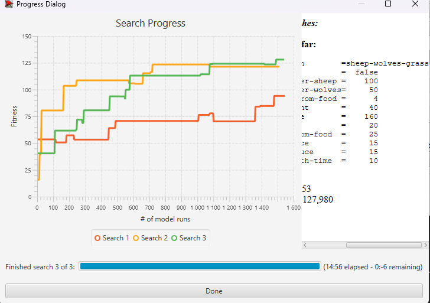
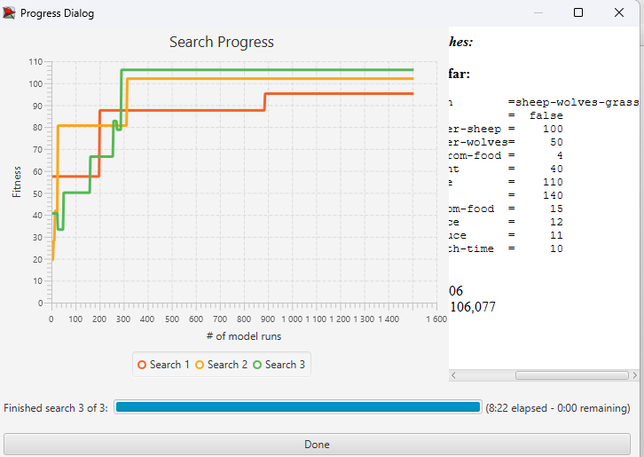
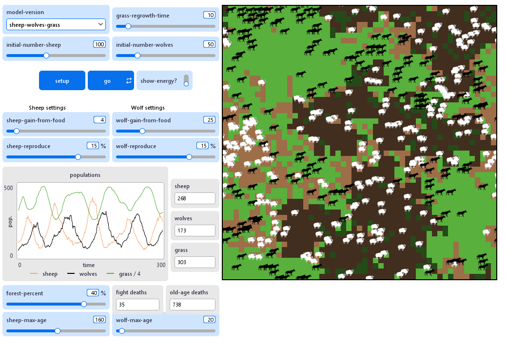
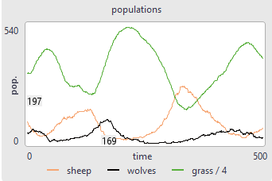
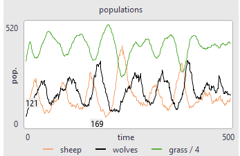

## Комп'ютерні системи імітаційного моделювання
## СПм-25-1, Турбаба Данило Володимирович
### Лабораторна робота №**3**. Використання засобів обчислювального інтелекту для оптимізації імітаційних моделей

 

### Варіант 7, модель у середовищі NetLogo:
[Wolf Sheep Predation](http://www.netlogoweb.org/launch#http://www.netlogoweb.org/assets/modelslib/Sample%20Models/Biology/Wolf%20Sheep%20Predation.nlogo)

Для оптимізації використано **змінену у ЛР2 версію моделі**: [wsp_lab3.nlogox](wsp_lab3.nlogox). Вона ідентична моделі `Wolf Sheep Predation (ЛР2).nlogox` з лабораторної роботи №2. Інструменти: NetLogo 7.0.4 і BehaviorSearch 1.10, що входить до його складу.

 

#### Вербальний опис моделі:
Модель екосистеми «хижак – жертва – ресурс». Вівці харчуються травою, вовки - вівцями. Кожен крок коштує тварині енергії, тварина з від'ємною енергією гине. З певною ймовірністю тварина народжує нащадка і віддає йому половину енергії. З'їдена трава відростає через `grass-regrowth-time` тактів. Детальний опис наведено у ЛР1.

Зміни з ЛР2:
- вовки - одинаки: обирають сусідню ділянку з вівцями і без інших вовків; двоє вовків на ділянці - залишається сильніший;
- вівці тікають від вовка на сусідній ділянці або ховаються в лісі;
- **ліс** (`forest-percent`) - укриття для овець, куди вовки не заходять, а трава відростає втричі повільніше;
- **старіння** (`sheep-max-age`, `wolf-max-age`) - тварина помирає, досягнувши граничного віку.

#### Керуючі параметри:
- **initial-number-sheep**, **initial-number-wolves**: початкова кількість овець і вовків.
- **sheep-gain-from-food**, **wolf-gain-from-food**: енергія від з'їденої трави та вівці.
- **sheep-reproduce**, **wolf-reproduce**: ймовірність народження нащадка за такт, %.
- **grass-regrowth-time**: час відростання трави, тактів.
- **forest-percent**: частка поля під лісом, %.
- **sheep-max-age**, **wolf-max-age**: граничний вік, тактів.

#### Показники роботи моделі:
- кількість овець (`count sheep`), вовків (`count wolves`), ділянок із травою (`count grass`);
- кількість вовків, загиблих у сутичках (`fight-deaths`), і тварин, що померли від старості (`old-age-deaths`).

 

### Постановка задачі оптимізації
**Мета:** знайти параметри, за яких **обидва види стійко співіснують якомога більшими популяціями**.

Якщо просто максимізувати кількість вовків або овець, пошук знайде «нечесне» рішення: один вид розмножиться вибухоподібно, а другий вимре. Тому як показник ефективності обрано **кількість того виду, якого зараз менше**:
<pre>
min (list count sheep count wolves)
</pre>
Цей показник автоматично «штрафує»:
- **вимирання**: якщо вовків (або овець) не лишилось, показник дорівнює 0 до кінця симуляції;
- **дисбаланс**: 300 овець при 10 вовках дає лише 10.

Показник усереднюється за всі 500 тактів симуляції, тобто винагороджується стійкість упродовж усього прогону, а не вдалий момент наприкінці.

 

### Налаштування середовища BehaviorSearch:

Модель обрав з другої лабораторної.

**Параметри моделі** (вкладка Model). Частина параметрів зафіксована, щоб звузити простір пошуку і зробити розв'язки порівнянними з попередніми лабораторними:
<pre>
["model-version" "sheep-wolves-grass"]
["show-energy?" false]
["initial-number-sheep" 100]
["initial-number-wolves" 50]
["sheep-gain-from-food" 4]
["forest-percent" [0 5 40]]
["sheep-max-age" [20 10 200]]
["wolf-max-age" [20 10 200]]
["wolf-gain-from-food" [5 5 60]]
["wolf-reproduce" [1 1 15]]
["sheep-reproduce" [1 1 15]]
["grass-regrowth-time" [10 10 100]]
</pre>
Шукаються 7 параметрів, причому 3 з них (`forest-percent`, `sheep-max-age`, `wolf-max-age`) додані у ЛР2. Розмір простору пошуку: 9 × 19 × 19 × 12 × 15 × 15 × 10 ≈ **87,7 млн** комбінацій, тож повний перебір неможливий.

Інші налаштування вкладки:
- **Setup**: `setup`, **Step**: `go` - процедури ініціалізації та кроку моделі;
- **Measure**: `min (list count sheep count wolves)`;
- **Measure if**: `true` - показник враховується на кожному такті;
- **Stop if**: не використовується. Зупинка при вимиранні вовків вкоротила б прогін, і середнє рахувалось би лише за такти до вимирання, тобто «погане» рішення отримало б завищену оцінку;
- **Step limit**: `500`.

**Налаштування цільової функції** (вкладка Search Objective):
- **Goal**: `Maximize Fitness`;
- **Collected measure**: `MEAN_ACROSS_STEPS` - середнє показника за всі такти прогону;
- **Fixed Sampling**: `3` replicates - кожен набір параметрів запускається 3 рази з різними випадковими числами, бо модель сильно стохастична;
- **Combine replicates**: `MEAN`.

**Налаштування алгоритму пошуку** (вкладка Search Algorithm):

| | Генетичний алгоритм | Випадковий пошук |
|---|---|---|
| Search method | `StandardGA` | `RandomSearch` |
| mutation-rate | 0,03 | - |
| population-size | **30** (замість 50 за замовчуванням) | - |
| crossover-rate | 0,7 | - |
| population-model | generational | - |
| tournament-size | 3 | - |
| Search Encoding Representation | `GrayBinaryChromosome` | `GrayBinaryChromosome` |
| Use fitness caching | так | так |
| Evaluation limit | **1500** запусків моделі | **1500** запусків моделі |
| Best-checking replicates | 10 | 10 |

Розмір популяції ГА зменшено до 30. З урахуванням 3 повторів на кожну особину ліміт у 1500 запусків дає ~500 оцінок рішень, тобто ~16 поколінь, а не 10 при популяції 50. Обидва алгоритми отримали **однаковий бюджет**, тому порівняння чесне.

`Best-checking replicates = 10`: кожне знайдене «найкраще» рішення додатково перевіряється на 10 незалежних прогонах. Це захищає від рішень, яким просто пощастило на 3 прогонах.

**Повторні пошуки.** Кожен алгоритм запущено **3 рази** (Number of searches = 3, initial random seed = 7, 12 потоків). Один запуск ГА чи випадкового пошуку може бути вдалим або невдалим випадково, а три запуски показують, наскільки стабільно алгоритм знаходить хороший розв'язок. Тривалість: ~15 хв на кожен алгоритм.

Конфігурації збережено у файлах [ga.bsearch](ga.bsearch) і [rs.bsearch](rs.bsearch). Повна історія пошуку (усі запуски моделі та історія найкращих рішень) лежить у файлах `ga.*.csv` і `rs.*.csv`.

 

### Результати використання BehaviorSearch:

**Найкращі знайдені рішення** (фітнес - середнє значення `min(sheep, wolves)` за 500 тактів):

| Алгоритм | Пошук | forest-percent | sheep-max-age | wolf-max-age | wolf-gain-from-food | wolf-reproduce | sheep-reproduce | grass-regrowth-time | Фітнес (3 прогони) | Фітнес (перевірка, 10 прогонів) |
|---|---|---|---|---|---|---|---|---|---|---|
| ГА | 1 | 15 | 120 | 110 | 10 | 15 | 15 | 10 | 96,6 | 94,1 |
| ГА | 2 | 40 | 200 | 120 | 15 | 15 | 15 | 10 | 125,9 | 123,5 |
| ГА | **3** | **40** | **160** | **20** | **25** | **15** | **15** | **10** | **130,8** | **128,0** |
| Випадковий | 1 | 30 | 50 | 120 | 20 | 13 | 14 | 10 | 99,3 | 95,3 |
| Випадковий | 2 | 40 | 150 | 20 | 55 | 12 | 12 | 10 | 105,5 | 102,1 |
| Випадковий | 3 | 40 | 110 | 140 | 15 | 12 | 11 | 10 | 109,2 | 106,1 |
| | | | | | | | | **Середнє ГА** | | **115,2** |
| | | | | | | | | **Середнє випадкового** | | **101,2** |

Результат пошуку за допомогою **генетичного алгоритму** (вікно BehaviorSearch після завершення всіх трьох пошуків):

Результат пошуку за допомогою **випадкового пошуку** (вікно BehaviorSearch після завершення всіх трьох пошуків):

**Збіжність пошуку.** Як змінювалось найкраще знайдене значення в міру витрачання бюджету (видно і на графіках у вікнах BehaviorSearch вище). Найкращий фітнес після певної кількості запусків моделі:

| Запусків моделі | ГА, пошук 1 | ГА, пошук 2 | ГА, пошук 3 | Випадк., пошук 1 | Випадк., пошук 2 | Випадк., пошук 3 |
|---|---|---|---|---|---|---|
| 150 | 53,3 | 83,6 | 66,2 | 59,2 | 78,9 | 54,4 |
| 300 | 65,1 | 107,2 | 84,0 | 84,2 | 78,9 | 109,2 |
| 750 | 73,6 | 125,9 | 118,6 | 84,2 | 105,5 | 109,2 |
| 1500 | 96,6 | 126,7 | 130,8 | 99,3 | 105,5 | 109,2 |

 

### Перевірка знайдених параметрів у NetLogo
Знайдені параметри перевірено в NetLogo окремо від BehaviorSearch: **по 10 прогонів по 500 тактів** для кожного набору (Командний центр, дані у файлі `verify.csv`). Для порівняння взято також параметри за замовчуванням: `forest-percent` = 15, вік 100/100, `wolf-gain-from-food` = 20, `wolf-reproduce` = 5, `sheep-reproduce` = 4, `grass-regrowth-time` = 30.

*Фітнес - це та сама величина, яку максимізував BehaviorSearch: середня за прогін кількість того виду, якого менше, тобто `min(вівці, вовки)`. Чим він більший, тим чисельніші обидва види одночасно.*

| Набір параметрів | Фітнес: min(вівці, вовки), середнє | Фітнес, мін–макс за 10 прогонів | Вівці, середнє | Вовки, середнє | Прогонів, де вимерли вовки |
|---|---|---|---|---|---|
| За замовчуванням | 33,4 | 26,0 – 41,5 | 90,8 | 37,2 | 1/10 |
| Найкращий ГА (пошук 3) | **126,9** | 119,4 – 134,7 | 158,1 | 168,0 | **0/10** |
| Найкращий випадковий (пошук 3) | 104,7 | 97,4 – 110,8 | 143,6 | 124,8 | 0/10 |

Результат BehaviorSearch відтворюється: у NetLogo фітнес найкращого рішення ГА дорівнює 126,9 (BehaviorSearch при перевірці дав 128,0). Порівняно з параметрами за замовчуванням показник зріс **майже вчетверо**, а вовків стало в 4,5 раза більше без жодного вимирання.

Модель при знайдених ГА параметрах після 300 тактів:

Динаміка популяцій до та після оптимізації: графіки **populations** безпосередньо з інтерфейсу NetLogo, 500 тактів, `random-seed 1`.

**До оптимізації** (параметри за замовчуванням: `forest-percent` = 15, `sheep-max-age` = 100, `wolf-max-age` = 100, `wolf-gain-from-food` = 20, `wolf-reproduce` = 5, `sheep-reproduce` = 4, `grass-regrowth-time` = 30):

**Після оптимізації** (параметри, знайдені ГА: `forest-percent` = 40, `sheep-max-age` = 160, `wolf-max-age` = 20, `wolf-gain-from-food` = 25, `wolf-reproduce` = 15, `sheep-reproduce` = 15, `grass-regrowth-time` = 10):

До оптимізації популяції роблять кілька повільних великих коливань, і в окремі моменти вовків лишається зовсім мало. Після оптимізації коливання частіші, але дрібніші відносно рівня популяцій, а вовків і овець увесь час багато: обидві лінії тримаються значно вище нуля.

 

### Висновки
**Порівняння алгоритмів:**
- **ГА знайшов кращий розв'язок.** Найкращий результат ГА (128,0) на ~20% кращий за найкращий результат випадкового пошуку (106,1). У середньому за трьома запусками ГА також кращий: 115,2 проти 101,2.
- **Випадковий пошук швидше стартує, але рано «застигає».** На перших ~300 запусках він не поступається ГА, а в пошуку 3 навіть знайшов 109,2 раніше за будь-який із ГА. Далі він майже не покращується: у пошуку 3 після ~300-го запуску, у пошуку 2 після ~320-го. ГА продовжує покращувати рішення до кінця бюджету, бо кросовер комбінує вдалі «гени» різних особин.
- **У ГА видно розкид між запусками.** Пошук 1 застряг на рішенні з `forest-percent` = 15 і `wolf-gain-from-food` = 10 і досяг лише 94,1, тобто гірше за всі випадкові пошуки. Це ілюструє передчасну збіжність: популяція швидко стала однорідною навколо локального оптимуму, а низька ймовірність мутації (0,03) не дозволила з нього вибратись. Тому одного запуску ГА для висновків недостатньо.

**Що «вибрав» алгоритм (інтерпретація):**
- **Усі 6 найкращих рішень мають `grass-regrowth-time` = 10**, тобто мінімально можливе значення. У ЛР1 (експеримент 3) у **вихідній** моделі настільки швидка трава викликала «парадокс збагачення»: вибухові коливання і вимирання вовків у 4 прогонах із 5. Тут же, у **зміненій** моделі, система стійка (0/10 вимирань). Різниця пояснюється лісом: 5 із 6 найкращих рішень мають багато лісу (30–40%), а укриття згладжує коливання, як показала ЛР2. Отже, ліс дозволяє системі «витримати» багате середовище без обвалу.
- **Ймовірності розмноження обох видів тяжіють до максимуму** (11–15%). Найкращі рішення відповідають стратегії «швидкого життя»: багато народжень, швидкий обіг поколінь, великі популяції.
- **Граничний вік вовків майже не впливає на результат.** Найкращі рішення ГА мають `wolf-max-age` = 20 (пошук 3) і 120 (пошук 2) за майже однакового фітнесу (128,0 і 123,5). Цільова функція «пласка» за цим параметром: при високій плодючості вовки й так рідко доживають до старості.
- **Чесне застереження:** кілька найкращих значень лежать **на межах** діапазонів пошуку (`grass-regrowth-time` = 10, `wolf-reproduce` і `sheep-reproduce` = 15, `forest-percent` = 40). Імовірно, за ширших діапазонів оптимум був би ще далі. Також треба пам'ятати, що мета «більші популяції» штовхає до максимальної плодючості; за іншої мети, наприклад мінімізації коливань, відповідь була б іншою.
